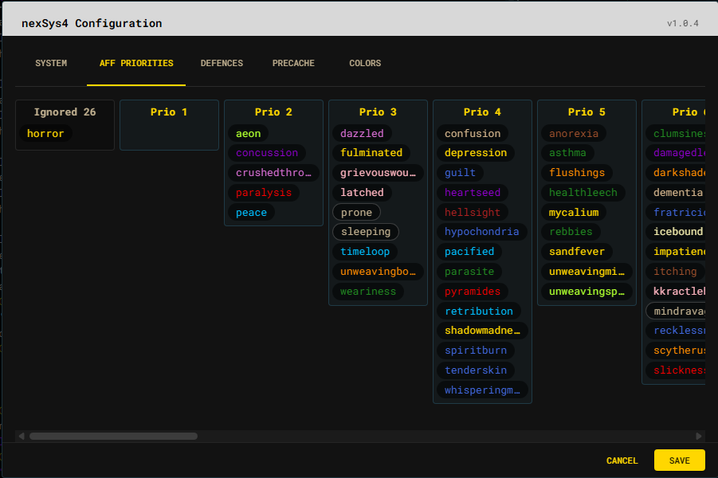

# Affliction priorities

This tab sets your default affliction priorities: the order in which
Achaea's server-side curing deals with your afflictions.

## Reading the tab

- Each column is a priority. **Prio 1** is the most urgent, and urgency
  falls column by column to **Prio 25**. Scroll sideways to see them all.
- The first column, **Ignored 26**, holds afflictions that server-side
  curing never cures. Achaea treats priority 26 as "ignore", and nexSys shows
  its own `0` the same way.
- Only afflictions that server-side curing can cure are listed. The rest are
  tracked by nexSys but can't be prioritized here.

## Changing a priority

Drag an affliction to another column, then select **Save**. Only the column
matters; the order of afflictions within a column isn't saved.

## How priorities work

- Achaea cures with whichever curing balance is free (herb, salve, smoke,
  sip, focus, tree), and on that balance it cures the most urgent affliction
  it can.
- A cure that treats several afflictions removes a random one of those you
  have. A priority therefore really ranks cures. Raising one ginseng
  affliction means "eat ginseng sooner", not "cure this affliction next".
- The order between afflictions that share a priority isn't defined. If the
  order of two afflictions matters to you, give them different priorities.

## Leave columns 1 to 3 free

nexSys's recommended priorities start at 4. Columns 1 to 3 are kept free for
[rules](../rules.md), which move an affliction there when the situation calls
for it: asthma during aeon, for example. If you fill those columns yourself,
rules can no longer put an affliction ahead of yours.

## Defaults and temporary changes

What you save here is your default. A rule may move an affliction for a
while, and when the rule stops applying, your default comes back. Rules never
change your saved defaults. If you change a priority by hand in game, nexSys
keeps your change until the end of the session. See
[Curing and priorities](../curing.md) for the full picture.
