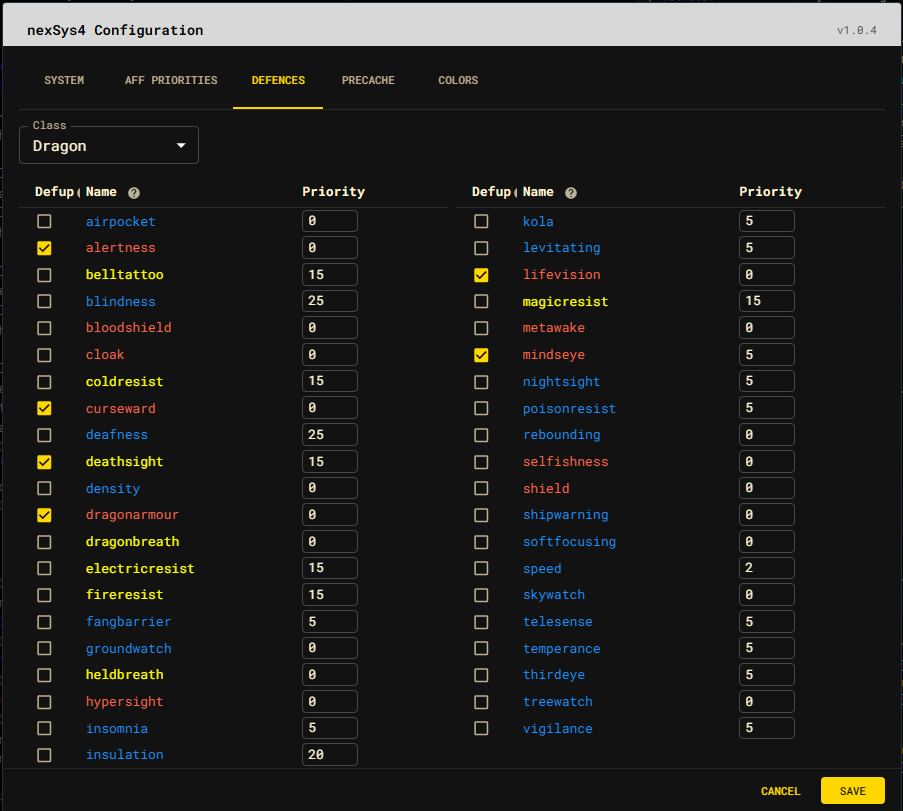

# Defences

This tab decides which defences nexSys looks after, how, and in what order.

## Choosing a class

The **Class** list starts on your current class. It shows that class's
defences together with the general ones every class can use. Pick
**All Classes** to see everything, or another class to set up a character
you play in more than one class.

## Setting up a defence

Each defence has two controls:

| Control | What it means |
| --- | --- |
| **Priority** | `1` to `25`: nexSys looks after this defence, and lower numbers go up first. `0` (or `26`): nexSys leaves it alone. |
| **Defup** | Checked: the defence goes up only when you type `defup`. Unchecked: nexSys keeps it up all the time and raises it again whenever it drops. |

A defence needs a priority from 1 to 25 for either mode to do anything. A
checked Defup box with priority `0` does nothing.

Select **Save** when you're done.

### Which mode to use

- **Keep up (Defup unchecked)** suits defences you always want: free ones
  such as kola, and anything you would otherwise put back up by hand after
  it's stripped.
- **Defup (checked)** suits defences you raise before a fight: ones that are
  costly to keep re-raising, or that you only want at certain times. After
  `defup` raises it, a Defup defence isn't raised again until your next
  `defup`.

## Name colors

Defence names are colored by what it costs to raise them. Hover over the
**Name** header in the window for a reminder.

| Color | Meaning | Suggested priority |
| --- | --- | --- |
| Red | Raising it uses up balance or equilibrium. | Lowest |
| Amber | Free, but you need balance or equilibrium to raise it. | Middle |
| Green | A free action. | Highest |

These are suggestions, not rules. Review what your class needs before you
copy another character's setup.

## Defences that exclude each other

Some defences can only be held one at a time, such as the four `avoid`
stances or parrying and guarding different limbs. When you give one of them a
priority, the window sets the others in its group back to `0`.

`parrying nothing` is part of the parrying group: you hold it whenever you
aren't parrying a limb. Give it a priority to have nexSys keep your parry
down, sending `parry nothing` if a parry goes up.

## Who raises the defence

Most defences are raised by Achaea's server-side curing. A few that the
server can't handle are raised by nexSys itself. These include parrying and
guarding, blocking, the avoid stances, prismatic, and several Alchemist
forms. They all share this one list and behave the same way to you.

## Related commands

| Command | Effect |
| --- | --- |
| `defup` | Raise every missing defence that has a priority, including the Defup ones. |
| `defoff` | Stop raising defences until your next `defup`. |
| `ma`, `br`, `ss`, `cl` | Turn density, held breath, rebounding, or cloak upkeep on or off. |
| `p<limb>`, `block <direction>`, `ub` | Parry a limb or block an exit, and keep it up. |

See [Commands](../commands.md) for details.
