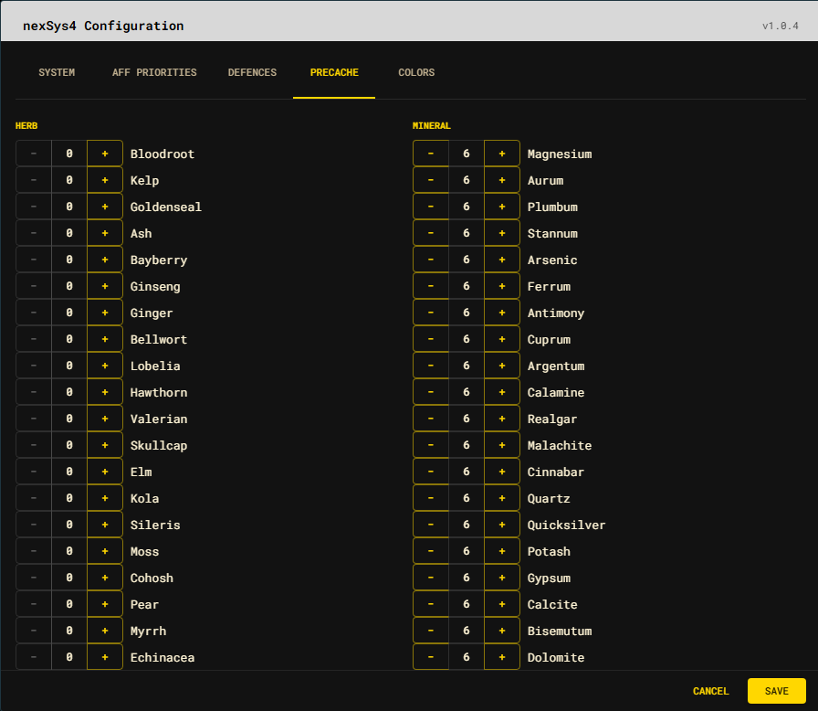

# Precache

Precache keeps a set number of each curative in your inventory, with the
rest stored in your rift. Herbs and their mineral equivalents are shown side
by side.

## Setting amounts

Use **+** and **-** to set how many of each item you want to carry, then
select **Save**.

## What nexSys does with the number

The number is exactly how many you want in your inventory:

- **Fewer than that?** nexSys takes the difference out of your rift
  (`OUTR`), as long as the rift has some.
- **More than that?** nexSys puts the extras back into your rift (`INR`),
  as long as the rift has room.

With the default of `0`, nexSys keeps none of that curative in your
inventory, and any you pick up go back into the rift.

## When precache waits

nexSys only moves curatives once it knows both your inventory and your rift
contents, which it reads during startup. It holds off while nexSys is
paused or in slow mode (for example under aeon), while you have prismatic
up, and while both of your arms are damaged, mangled, or broken.

## Checking your counts

The amounts you set are a target, not a claim about what you have. Scripters
can see the live counts in `nexSys.state.cache`: `inventory`, `rift`, and
`desiredPrecache`. See the [State reference](../../reference/state.md).

Irid moss uses the key `irid`, paired with `potash`. For example,
`nexSys.api.ss.precache.set({ irid: 2 })` keeps two pieces in your inventory.
