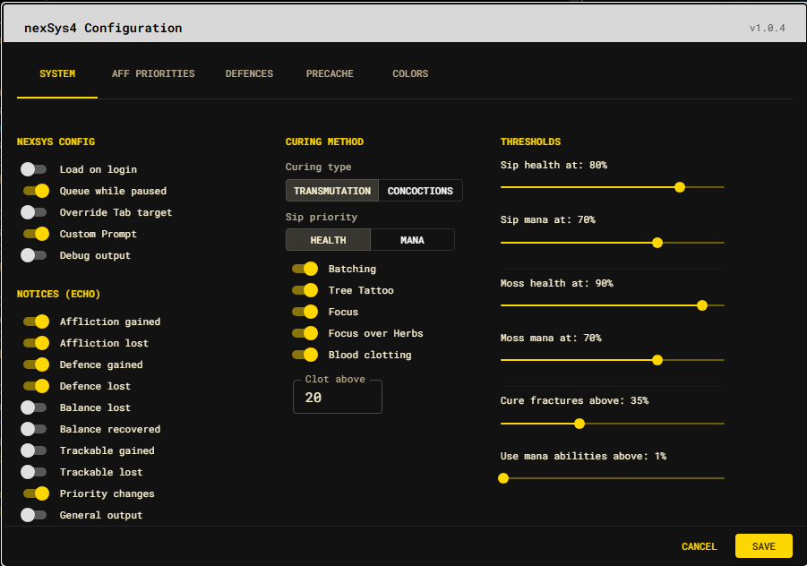

# System settings

The System tab holds nexSys's own switches, the notices it prints, and your
server-side curing settings. The last column of each table shows the Achaea
`CURING` setting that nexSys manages for you, so you can look it up with
`HELP CURING`.

## nexSys Config

| Setting | Default | What it does |
| --- | --- | --- |
| Load on login | Off | Start nexSys automatically when you log in. When it's off, type `ns load` after logging in. |
| Queue while paused | Off | Keep sending queued commands while nexSys is paused. When it's off, queued commands wait until you resume. |
| Override Tab target | Off | Make **Tab** complete names instead of using Nexus's normal Tab targeting. Type the start of a name and press Tab to cycle through matching enemies (from nexGui4) and online players. |
| Custom Prompt | On | Show the nexSys prompt in place of the game's. See [Custom prompt](../custom-prompt.md). |
| Debug output | Off | Write detailed diagnostics to the browser console and show the normally hidden startup output. Only needed for troubleshooting, and it turns itself off the next time nexSys loads. |

## Notices

Notices are the short `[-nexSys-]` lines nexSys prints in the game window.
They only change what you see. nexSys tracks everything whether a notice is
on or off.

| Notice | Default | Shows |
| --- | --- | --- |
| Affliction gained | On | `+aff asthma` when you gain an affliction |
| Affliction lost | On | `-aff asthma` when an affliction is cured |
| Defence gained | On | `+def rebounding` when a defence goes up |
| Defence lost | On | `-def rebounding` when a defence drops |
| Balance lost | Off | `offBal` when you use a balance |
| Balance recovered | Off | `onBal` when a balance comes back |
| Trackable gained | Off | When a tracked effect starts, such as being snapped |
| Trackable lost | Off | When a tracked effect ends |
| Priority changes | On | When you or a script change a priority. Changes made by rules are not shown. |
| General output | Off | Every batch of commands nexSys sends, plus status messages such as startup complete or death detected |

A few important messages are always shown, whatever these switches say. They
include a failed startup and a switch away from nexSys's curing set.

## Curing Method

| Setting | Default | What it does | Achaea setting |
| --- | --- | --- | --- |
| Curing type | Transmutation | Cure with **Transmutation** (minerals) or **Concoctions** (herbs). | `CURING TRANSMUTATION` |
| Sip priority | Health | What to sip first when both health and mana are below their thresholds. The `hh` alias swaps it. | `CURING PRIORITY HEALTH`/`MANA` |
| Batching | On | Send several cures at once where possible. | `CURING BATCH` |
| Tree Tattoo | On | Use your tree tattoo to cure. | `CURING TREE` |
| Focus | On | Use the Focus ability to cure. | `CURING FOCUS` |
| Focus over Herbs | On | Try Focus before herbs. Shown only while Focus is on. | `CURING FOCUS FIRST`/`SECOND` |
| Focus with Guilt | Off | Allow Focus while afflicted with guilt. Shown only while Focus is on. | `CURING FOCUS WITHGUILT`/`WITHOUTGUILT` |
| Focus with Fulminated | Off | Allow Focus while afflicted with fulminated. Shown only while Focus is on. | `CURING FOCUS WITHFULMINATED`/`WITHOUTFULMINATED` |
| Blood clotting | On | Use Clot to stop bleeding. | `CURING USECLOT` |
| Clot above | 19 | Clot once your bleeding reaches this amount. Shown only while Blood clotting is on. | `CURING CLOTAT` |
| Clot down to | 0 | Continue clotting down to this amount of bleeding. Zero uses the server default. Shown only while Blood clotting is on. | `CURING CLOTTO` |

## Thresholds

Thresholds are percentages of your maximum health or mana.

| Setting | Default | What it does | Achaea setting |
| --- | ---: | --- | --- |
| Sip health at | 80% | Sip a health elixir when health falls below this. | `CURING SIPHEALTH` |
| Sip mana at | 70% | Sip a mana elixir when mana falls below this. | `CURING SIPMANA` |
| Moss health at | 90% | Eat irid moss or potash when health falls below this. | `CURING MOSSHEALTH` |
| Moss mana at | 80% | Eat irid moss or potash when mana falls below this. | `CURING MOSSMANA` |
| Cure fractures above | 35% | Apply health to cure fractures only while health is above this. | `CURING HEALTHAFFSABOVE` |
| Use mana abilities above | 10% | Use curing abilities that cost mana only while mana is above this. | `CURING MANATHRESHOLD` |

## How these settings are applied

When you select **Save**, nexSys stores your settings and sends Achaea only
the ones that differ from what the server has. Rules can change these
settings for a while. For example, under aeon nexSys lowers the sip and moss
thresholds and turns batching off. When the situation ends, your saved values
return. See [How nexSys works](../how-it-works.md#slow-mode-and-aeon).

Achaea omits the guilt and fulminated focus options from `CURING STATUS`.
nexSys explicitly sends both saved preferences during every startup, including
when Focus is off, and tracks the game's text confirmations. Without a saved
preference, it sends `CURING FOCUS WITHOUTGUILT` and
`CURING FOCUS WITHOUTFULMINATED`.
