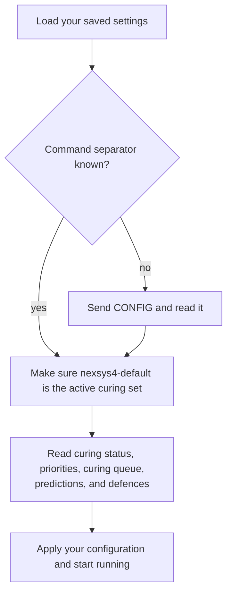
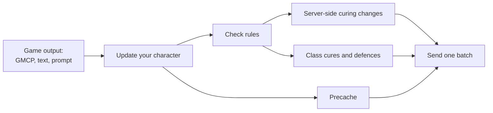

# How nexSys works

You don't need this page to use nexSys. Read it when you want to know why
nexSys did something, or to make sense of what you see on screen.

## The short version

nexSys reads three things the game sends: GMCP data (vitals, afflictions,
defences, items, the room), the lines of text on your screen, and the prompt.
From these it keeps an up-to-date picture of your character. At each prompt,
it works out what needs to change and sends it to the game in one batch.

Most curing is done by Achaea's own server-side curing. nexSys configures it
and keeps adjusting it as the fight changes. It also handles what the server
can't do on its own: class cures, the defences the server doesn't manage, and
your curatives.

## Startup

1. nexSys loads your saved settings.
2. It finds your in-game command separator. If it doesn't know it yet, it
   sends `CONFIG` and reads it from the output, then remembers it. If you
   change your separator while nexSys is loaded, nexSys notices. Everything
   nexSys sends depends on this separator, which must differ from the Nexus
   Command Stack Delimiter. See
   [Set your command separator](../getting-started/installation.md#1-set-your-command-separator).
3. It makes sure its own curing set, `nexsys4-default`, exists and is
   active, creating it or switching to it if needed.
4. It reads your curing status, affliction and defence priorities, curing
   queue, predictions, and current defences.
5. It corrects anything on the server that differs from your configuration,
   and starts running.

The startup output is hidden. When it's finished, you see
`[-nexSys-] loaded using startup spam gag.` If startup can't finish, nexSys
stays paused and usually says why. See
[nexSys does not start](../troubleshooting.md#nexsys-does-not-start).

### The nexsys4-default curing set

nexSys only ever changes its own curing set, `nexsys4-default`, and leaves
your other sets alone. The first time it creates the set, it fills it with
your nexSys configuration (or nexSys's recommended defaults) rather than
Achaea's stock priorities.

If you switch to another curing set while nexSys is running, nexSys stops
sending anything and tells you. It carries on as soon as you switch back to
`nexsys4-default`.

## Every prompt

1. **Update.** nexSys applies everything that happened since the last prompt:
   afflictions, defences, balances, vitals, limbs, curatives, and the room.
2. **Check rules.** Each [rule](./rules.md) looks at the situation and can ask
   for a temporary change, for example "cure asthma first". The changes
   from every active rule are combined.
3. **Server-side curing.** nexSys compares the curing it wants (your
   configuration plus the rule changes) with what the server has, and sends
   only the differences. Usually that's nothing, or a single
   `CURING PRIORITY` command.
4. **Class cures and defences.** nexSys plans what the server can't do: class
   cures such as Fitness, and the defences nexSys raises itself. Free
   actions are sent straight away. Actions that need balance or equilibrium
   go into the free [queue](./queues.md), one at a time, so they fire the
   moment you can act.
5. **Precache.** nexSys moves curatives between your inventory and your
   rift to match your [precache](./configuration/precache.md) amounts.
6. **Send.** Everything goes out together. When a batch changes curing or
   moves curatives, nexSys waits until the game has fully processed it
   before planning again, so it never acts on out-of-date information. If
   that confirmation never arrives, nexSys recovers by itself after a short
   time. `ns stuck` forces it straight away.

### When you change curing yourself

If you change a curing setting or priority by hand in game, for example with
`CURING PRIORITY`, nexSys goes along with it for the rest of the session
instead of changing it back. The exception is a value that a rule is
controlling at that moment: the rule wins. Your saved configuration isn't
changed, so the next time nexSys starts, your configuration applies again. To
change something permanently, use the configuration window.

## Pausing

| What happened | What nexSys does |
| --- | --- |
| You typed `pp` | Pauses: turns server-side curing off, stops sending commands, and holds queued commands unless **Queue while paused** is on. Type `pp` again to resume. |
| You typed `CURING OFF` yourself | Pauses as well, and resumes when you type `CURING ON`. |
| You died | Pauses, and resumes when you're resurrected. |
| You switched to another curing set | Stops sending anything until you switch back to `nexsys4-default`. Achaea keeps curing with the set you chose. |
| A rule suspended curing | Turns curing off while the rule is active. |

The prompt shows `(p)` when nexSys is paused by `pp`, by `CURING OFF`, or by
death. A curing-set switch is announced with a notice instead, and a rule
that holds curing off shows up in `nexSys.state.rules`. Either way, nexSys
keeps tracking your character, so it's up to date the moment it resumes.

## Slow mode and aeon

While you have aeon, nexSys switches to slow mode, shown as `(a)` and `(r)` on
the prompt. Under aeon every action is slow, so nexSys:

- lowers the sip and moss thresholds and turns off batching, so curing doesn't
  waste actions,
- raises the clotting threshold, so it doesn't waste actions clotting,
- moves asthma, weariness, anorexia, impatience, and paralysis to the front
  of the curing order,
- pauses precaching.

Everything returns to normal once aeon is cured.

## Queues

Queued commands work separately from the prompt cycle. When you queue a
command, nexSys sends it to one of Achaea's server queues, and the game runs
it as soon as you have the balance it needs. nexSys keeps track of what's
queued and notices when a queue fires. See [Queues](./queues.md).

## Updates and saved settings

Each time nexSys loads, it downloads the latest version of the nexSys4
package and applies it. Your configuration is saved in the Nexus variable
`nexSys4Settings`, and your own reflexes live in the `nexSys4.userSettings`
group. Updates keep both. See [Updates](../getting-started/installation.md#updates).
